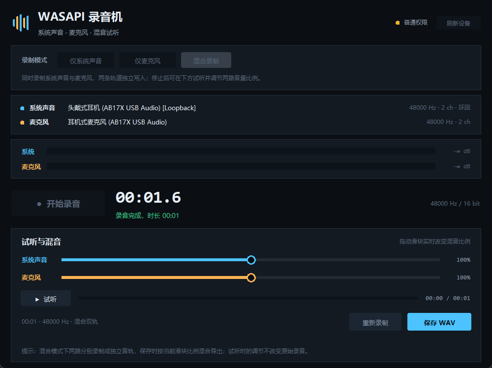

# WASAPI 录音机 · wasapi_recorder

一个 Windows 上的三模式录音工具：**只录系统声音（扬声器/耳机环回）**、**只录麦克风**、或**两者同时录并混音**。
停止后可以试听，拖动两个滑块实时调整两路音量的比例，再导出 WAV。

A small Windows recorder built on WASAPI loopback: capture the speakers/headphones, the microphone,
or both at once — then preview, balance the two tracks with sliders, and export a WAV.
Everything runs locally; the program has no network code.



## 功能

| 功能 | 说明 |
| --- | --- |
| 仅系统声音 | 录制默认播放设备（扬声器或耳机）的 WASAPI 环回，跟着系统默认输出走 |
| 仅麦克风 | 录制默认麦克风 |
| 混合录制 | 两路同时录制，各自写入独立音轨；停止后进入试听界面 |
| 实时电平 | 两条峰值表，带峰值保持与 dB 读数，回调线程只做入队和算电平 |
| 混音试听 | 拖动「系统声音 / 麦克风」滑块（0–200%），边放边改比例 |
| 导出 | 按当前滑块比例混合导出 16 bit 立体声 WAV |
| 权限 | exe 自带 `requireAdministrator` 清单，双击即弹 UAC；从源码启动时也会自动提权重启 |

## 下载 / 运行

到 [Releases](../../releases) 下载 `WasapiRecorder.exe`，双击后在 UAC 提示中选择「是」。

单文件版首次启动会解压到临时目录，约 1–2 秒；程序只把录音缓存写到
`%LOCALAPPDATA%\WasapiRecorder`，退出或「重新录制」时删除。

### 从源码运行

```bat
python -m pip install -r requirements.txt -i https://pypi.tuna.tsinghua.edu.cn/simple
python app.py
```

调试时不想每次弹 UAC：

```bat
python app.py --no-elevate
```

## 打包

```bat
build.bat
```

或手动：

```bat
python -m pip install pyaudiowpatch -i https://pypi.tuna.tsinghua.edu.cn/simple
python -m pip install pyinstaller -i https://pypi.tuna.tsinghua.edu.cn/simple
python build.py
```

`build.py` 用 `build.spec` 生成单文件 exe（`--onefile --windowed --uac-admin`），
并在构建完成后读取 PE 资源，确认清单里确实是 `requireAdministrator`。

## 实现要点

### 1. 回环设备怎么选

`audio_devices.default_loopback()` 先取 WASAPI 主机的 `defaultOutputDevice`，再用
`get_wasapi_loopback_analogue_by_index()` 找到它的 `[Loopback]` 分身。
所以插上耳机、系统默认输出切到耳机后，下一次录音采到的就是耳机里的声音。
（WASAPI 流在打开时就绑定了端点，录音途中切换设备不会自动迁移，需要重新录。）

### 2. 没有声音时补齐静音

WASAPI 环回有个关键特性：**端点没有音频在渲染时，回调不再送数据**（系统音量为 0 或
纯粹没在放歌都可能这样），如果只是把收到的数据写进文件，文件会比实际录音时长短，
两路轨道也会错位。

`TrackWriter` 因此以「会话时钟」为准：

* 会话开始时记录 `t0 = perf_counter()`，两条轨道共用同一个 `t0`；
* 写线程每 12 ms 检查一次，若已写帧数落后于 `(now - t0) * rate` 超过 100 ms 的守护量，
  就补写等长的全零 PCM；
* 停止时再按 `[t0, stop_time]` 把尾巴补满，保证文件时长 == 实际录音时长，
  系统轨与麦克风轨永远等长（`Session.frames` 取两者最小值，导出时按它截断）。

### 3. 线程之间怎么隔离

```
PortAudio 回调线程 ──push(bytes)──> deque(有界 500 块) ──> 写线程(独占一个 WAV)
                          │
                          └──> peak / rms（原子写，UI 只读）

混音线程(读 WAV + 加增益) ──> 环形缓冲(≤0.3 s) ──> 播放回调(只拷贝)
```

* 音频回调里不碰磁盘、不碰 Tk、不拿会被长时间占用的锁，只做入队和电平计算，
  所以磁盘慢不会造成输入溢出（`dropped` 计数可以验证）；
* 每条轨道一个写线程，各自持有自己的 `wave.Wave_write`，不存在两个线程写同一文件；
* 播放侧由混音线程读文件、算增益，回调只从环形缓冲取数据，滑块调整增益不会阻塞发声；
* UI 只通过 `peak`、`frames`、`position_frames` 这些数值属性观察状态，从不跨线程操作控件。

### 4. 混音

`mixing.py` 用 `audioop`（C 实现）做增益与饱和相加，导出 20 分钟录音也是秒级；
在 Python 3.13（`audioop` 被移除）上会自动退回纯 Python 实现，功能一致但慢一些。

## 故障排查

**`[Errno -9992] Insufficient memory`（无法开始录音）**

这是 PortAudio 把 WASAPI 的底层错误归一化后的报错，最常见的场景是：**耳机 / USB 声卡处于空闲挂起状态**
（没有任何程序在放声音），环回客户端申请不到音频引擎的缓冲区；其次是设备实际支持的声道数/采样率
与请求值不符（USB 耳机的麦克风经常是单声道）。

程序已经内置了应对：

1. 先用请求的格式打开，失败后依次降级（声道数、采样率、缓冲区大小）；
2. 仍然失败时，在默认输出上开一条**静音保活流**把端点唤醒，再重试一次；
3. 每次尝试都会写进日志：`%LOCALAPPDATA%\WasapiRecorder\recorder.log`。

其它常见原因：会议软件 / 播放器以独占模式占用了设备；耳机刚插拔导致端点编号变化
（此时点「刷新设备」再试）；驱动不支持 48 kHz 双声道（程序会自动换成设备原生格式）。

## 已知限制

* 录音过程中切换默认播放设备不会自动切换音源；
* 播放器以独占模式占用声卡、或内容受 DRM 保护时，环回可能拿不到数据；
* 部分驱动在系统静音时仍会送零数据，此时不再额外补零（时长本来就对）；
* 单文件 exe 首次启动要解压到临时目录，约 1–2 秒。

## 文件结构

```
wasapi_recorder/
├─ app.py            入口：提权、DPI、启动窗口
├─ admin.py          UAC 检测与 ShellExecuteW("runas") 重启
├─ audio_devices.py  WASAPI 端点发现（默认输出回环 / 默认麦克风）
├─ recorder.py       采集：双流、双写线程、会话时钟补静音
├─ mixing.py         PCM 增益 / 混音 / WAV 导出
├─ player.py         试听：混音线程 + 环形缓冲 + 播放回调
├─ ui.py             主窗口与状态机
├─ ui_widgets.py     电平表、滑块、按钮等自绘控件
├─ build.py/.spec    打包与清单校验
├─ build.bat         一键安装依赖并打包（清华镜像）
└─ tests/            真实设备冒烟测试、界面截图脚本
```

## 测试

```bat
set WASAPI_RECORDER_DATA=%cd%\_records_test
python tests\test_smoke.py
```

会实际录音几秒（含 1 秒 880 Hz 测试音），验证：静音段补零、测试音被采到、
两轨等长、导出时长正确、增益为 0 不改时长。

```bat
python tests\ui_shot.py
```

依次截取「空闲 / 录音中 / 试听 / 播放中」四个界面到 `_shots/`。

## 关于 AI 辅助

这份代码是在 AI 辅助下完成的，如实说明：

* 需求定义、交互取舍、真机验证与缺陷定位由作者完成；
* 代码由 AI 生成初稿，随后在真实声卡上反复运行、测量并修正——包括线程停止事件与
  `Thread._stop()` 冲突、高 DPI 下窗口溢出屏幕、空闲耳机端点打开失败（`-9992`）等问题；
* 所有录音测试、界面截图与打包均在本机完成。

仓库不包含任何云端运行或数据上传逻辑。如果发现生成代码存在许可或质量问题，欢迎提 issue。

## 许可

本项目代码以 MIT 许可发布，详见 [LICENSE](LICENSE)；
第三方组件与许可见 [THIRD_PARTY_NOTICES.md](THIRD_PARTY_NOTICES.md)。

录音涉及隐私：本程序只在本机读写音频，不联网、不上传、不驻留，请自行确认录音行为的合法性。
